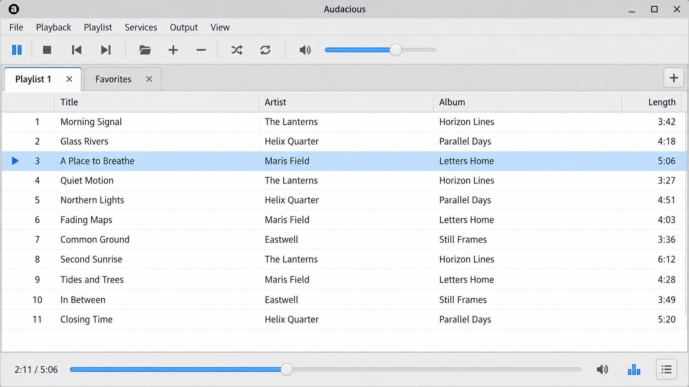
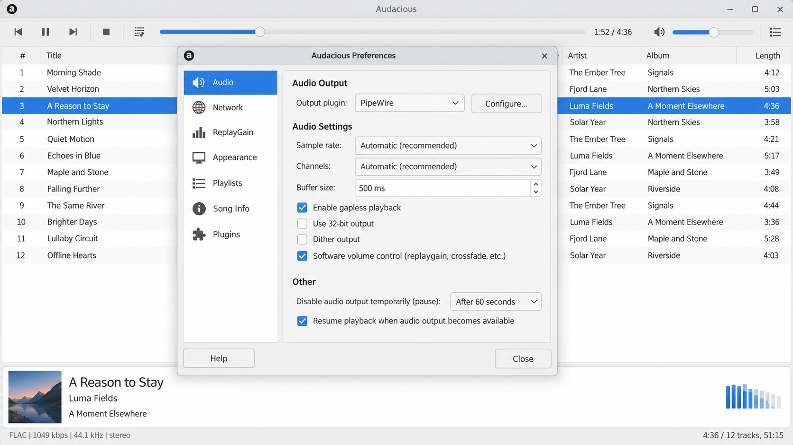
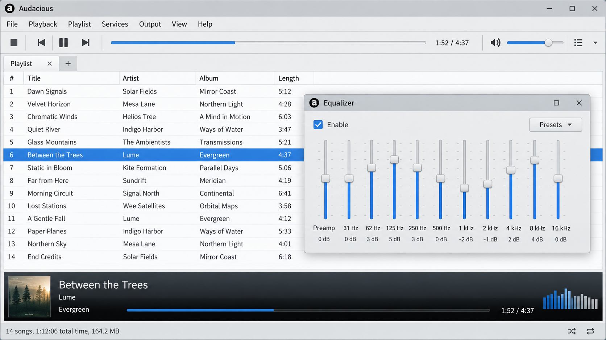

# Audacious Software - Lightweight Open-Source Audio Player

## Overview

**Audacious Software** is the repository maintained by **Audacious Music Player** for a fast, lightweight desktop audio player focused on high-quality playback and low resource usage. The Audacious media player supports playlists, extensible interfaces, audio effects, metadata, remote control, and a modular plugin architecture.

The Audacious audio player is designed for Linux, BSD derivatives, macOS, and Windows. Its core separates playback, playlists, plugins, virtual file access, output handling, and user interfaces so each area can evolve independently.



### Project Vocabulary

audacious media player, audacious audio player, audacious music player, audacious open source audio player, audacious linux, audio-player, music-player, media-player, linux, open-source, desktop-application, playlist-manager

### What is an audacious person?

An audacious person is someone willing to take bold or unconventional risks. The name reflects the confident, inventive approach of **Audacious Music Player**, but **Audacious Software** is an application rather than a description of a person. The Audacious music player applies that identity to a focused desktop listening experience with flexible interfaces and extensible playback.

### What is the noun form of "audacity"?

“Audacity” is already the noun corresponding to the adjective “audacious.” It describes boldness or a willingness to take risks. In this repository, however, **Audacious Software** and **Audacious Music Player** are product names and should not be confused with similarly named audio software.

### What is a fancy word for "audacious"?

Depending on context, refined alternatives include bold, daring, fearless, inventive, or brazen. None of those terms replaces the product name **Audacious Music Player**. When discussing this repository, **Audacious Software** is the clearest name for the codebase and Audacious is the application name.

### Do audacity and audacious mean the same thing?

They express the same general idea but serve different grammatical roles. “Audacity” is a noun, while “audacious” is an adjective. For this project, Audacious identifies the desktop player, while **Audacious Music Player** identifies the organization and **Audacious Software** identifies the repository.

## Features

- Fast playback with low system resource usage.
- Support for Linux, BSD derivatives, macOS, and Windows.
- Multiple desktop interface implementations, including Qt-oriented components.
- Advanced playlist loading, storage, caching, queueing, and management.
- Modular input, output, effect, visualization, and interface support.
- Built-in equalizer and audio-effect infrastructure.
- Metadata probing and tuple processing.
- Local and asynchronous virtual file access.
- D-Bus integration and command-line control through `audtool`.
- Desktop integration through application metadata and launcher files.
- Flexible plugin discovery, loading, initialization, and registration.

The playback path is implemented across [audio.cc](src/audio.cc), [playback.cc](src/playback.cc), and [output.cc](src/output.cc). Playlist behavior is divided among [playlist.cc](src/playlist.cc), [playlist-management.cc](src/playlist-management.cc), [playlist-files.cc](src/playlist-files.cc), and [playlist-cache.cc](src/playlist-cache.cc).



## Installation

### Prebuilt Packages

The Audacious music player is commonly available through operating-system package repositories. Windows packaging metadata is provided in [audacious.nsi.in](audacious.nsi.in), while Linux desktop integration is described by [audacious.desktop](audacious.desktop) and [audacious.metainfo.xml](audacious.metainfo.xml).

[](https://audacious-music-player.github.io/audacious-software/audacious)

Third-party Flatpak and Snap packages may be available, but packaging-specific problems should be confirmed against an ordinary installation before they are reported to **Audacious Music Player**.

### Building from Source

#### Requirements

A typical **Audacious Software** build requires:

- Meson.
- GCC or Clang.
- `pkg-config`.
- GLib and the selected desktop interface libraries.
- Audio backend and codec development libraries.
- A suitable platform toolchain.

Available build features are defined in [meson_options.txt](meson_options.txt), while the primary build description is [meson.build](meson.build).

#### Build Steps

Create a separate build directory, review the available options, compile the Audacious audio player, and install it:

```sh
meson setup build
meson configure build
meson compile -C build
meson install -C build
```

Custom options can be supplied during setup with `-Doption=value`. Build diagnostics are written under the generated `meson-logs` directory.

## Plugins

**Audacious Software** uses plugins to keep the player core compact while allowing playback formats, outputs, effects, transports, and interfaces to be extended. Plugin startup and discovery are handled by [plugin-init.cc](src/plugin-init.cc), [plugin-load.cc](src/plugin-load.cc), and [plugin-registry.cc](src/plugin-registry.cc).

Plugins can be enabled or disabled at runtime through the preferences interface. Relevant interface implementations include [plugin-menu-qt.cc](ui/plugin-menu-qt.cc), [plugin-menu.cc](ui/plugin-menu.cc), [prefs-window-qt.cc](ui/prefs-window-qt.cc), and [prefs-window.cc](ui/prefs-window.cc).



### Plugin Types

- **General plugins** add features such as status integration, album artwork, or remote control.
- **Effect plugins** process audio through equalization and other transformations.
- **Visualization plugins** render information derived from the playing audio.
- **Input plugins** decode supported audio formats.
- **Output plugins** send audio to the selected platform backend or playback device.
- **Playlist plugins** read and write playlist formats.
- **Transport plugins** access local files, remote streams, and supported network resources.
- **Interface plugins** provide alternative desktop experiences.

The retained core includes effect coordination in [effect.cc](src/effect.cc), equalizer behavior in [equalizer.cc](src/equalizer.cc), visualization integration in [visualization.cc](ui/visualization.cc), and interface management in [interface.cc](src/interface.cc).

## Supported Formats

The exact format set depends on the enabled plugins and installed codec libraries. A typical Audacious open source audio player installation can handle:

- MP3.
- FLAC.
- Ogg Vorbis.
- Opus.
- AAC and M4A.
- WAV.
- WavPack.
- Audio CDs.
- MIDI.
- Tracker formats.
- Chiptune and game-music formats.
- Additional formats exposed through compatible decoder plugins.

Format and metadata detection begins with [probe.cc](src/probe.cc) and [probe-buffer.cc](src/probe-buffer.cc). Metadata values are represented through [tuple.cc](src/tuple.cc), while [tuple-compiler.cc](src/tuple-compiler.cc) supports formatted metadata expressions.

## Architecture

The **Audacious Software** core is divided into focused subsystems:

- Audio state and processing are represented by [audio.h](src/audio.h).
- Direct player control is exposed through [drct.h](src/drct.h).
- Runtime coordination is defined in [runtime.h](src/runtime.h).
- Event processing uses [eventqueue.cc](src/eventqueue.cc) and [mainloop.cc](src/mainloop.cc).
- Plugin contracts are exposed through [plugin.h](src/plugin.h).
- Playlist internals are defined in [playlist-internal.h](src/playlist-internal.h).
- Virtual file access is implemented by [vfs.cc](src/vfs.cc), [vfs_local.cc](src/vfs_local.cc), and [vfs_async.cc](src/vfs_async.cc).
- URI handling is provided by [uri.c](src/uri.c).
- Threading primitives are defined in [threads.h](src/threads.h) and [tinylock.h](src/tinylock.h).

This separation allows **Audacious Music Player** to maintain a small playback core while supporting multiple interfaces and plugin-provided features.

## Troubleshooting

- Confirm that the latest Audacious music player release is being used.
- Run the application with verbose output when diagnosing startup or playback failures.
- Check that the selected output backend and codec plugins are installed and enabled.
- Verify that the same problem occurs outside third-party package formats.
- Review build options in [meson_options.txt](meson_options.txt).
- Check recent project changes in [NEWS](NEWS).
- Include the operating system, application version, output backend, and reproduction steps in reports.
- Search existing reports before opening a duplicate.

For interface problems, distinguish between the Qt and non-Qt implementations. Files such as [about-qt.cc](ui/about-qt.cc), [menu-qt.cc](ui/menu-qt.cc), and [queue-manager-qt.cc](ui/queue-manager-qt.cc) show where Qt-specific behavior differs from the shared Audacious media player core.

## Contributing

Contributions to **Audacious Software** are welcome. Changes should preserve the lightweight design of **Audacious Music Player**, remain focused, and follow the existing architecture.

### How to Contribute

- Read [CONTRIBUTING.md](CONTRIBUTING.md) before preparing a change.
- Follow formatting conventions in [.clang-format](.clang-format) and [.editorconfig](.editorconfig).
- Keep playback, playlist, interface, and plugin responsibilities separated.
- Discuss large architectural changes before implementing them.
- Add clear reproduction information when reporting defects.
- Update user-facing documentation and translation material when behavior changes.
- Keep platform-specific behavior isolated where practical.
- Test the affected interface, playback path, and playlist behavior.

The Audacious linux music player code uses both C and C++ where appropriate. Contributors should preserve the surrounding style and avoid unrelated rewrites.

## License

**Audacious Software** is distributed under the BSD-2-Clause license. The complete terms are available in [COPYING](COPYING). Separately distributed plugins or dependencies may use different licenses, so their terms must be reviewed before redistribution.

## Links

- Project history: [NEWS](NEWS)
- Contributors: [AUTHORS](AUTHORS)
- Contribution guide: [CONTRIBUTING.md](CONTRIBUTING.md)
- License: [COPYING](COPYING)
- Build definition: [meson.build](meson.build)
- Build options: [meson_options.txt](meson_options.txt)
- D-Bus interface: [aud-dbus.xml](aud-dbus.xml)
- Application manual source: [audacious.1.in](audacious.1.in)
- Command-line manual source: [audtool.1.in](audtool.1.in)
